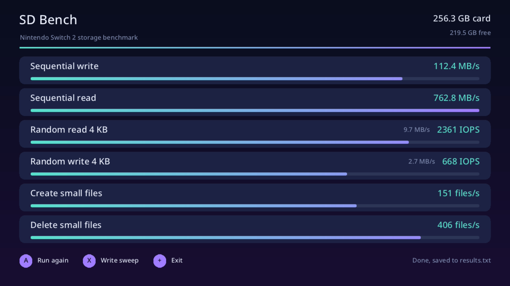

# SD Bench for Switch 2

**An SD card speed test for the Nintendo Switch 2, as native homebrew.** Run it on the console to see what your microSD or microSD Express card really does there, and compare two cards.

Built with the Switch 2 runtime and graphics driver of the [ounce-devkit](https://github.com/ouncebrew/ounce-devkit), not as a Switch 1 program in a compatibility layer. The source code is in this repository and the build is on the [Releases](../../releases) page.

## How to use it
1. Download `sdbench-nx2-1.0.0.zip` from the [Releases](../../releases) page and unzip it onto the root of the console's SD card.
2. Start **SD Bench** from the homebrew menu. The test runs by itself.

Nothing else to install. The test needs about 512 MB of free space on the card and removes its own files when it is done.

## What it measures
- **Sequential write and read** of a 512 MB file, in MB/s
- **Random read and write** with 4 KB blocks, in IOPS and MB/s
- **Small files:** how many 4 KB files per second it can create and delete

Press **X** for the **write sweep**: 256 MB written with 64 KB, 256 KB, 1 MB, 4 MB and 16 MB blocks, with 4 MB blocks and no final flush, and with 4 MB blocks into a file that was sized first. It shows how much of the write speed depends on the block size.

## Controls
| Button | What it does |
|---|---|
| A | run the test again |
| X | run the write sweep |
| Y | back to the main test (in the sweep) |
| + or B | exit |

## Results file
Every run is added to `switch/sdbench/results.txt` on the card, with the size of the card, so you can run it on two cards and compare the files.

## Notes
- The numbers are measured through the console's file system, exactly as a homebrew program sees it. They are not the raw speed of the card.
- The system can cache reads, so the read numbers can come out higher than the card can really deliver.
- Requires a Nintendo Switch 2 running kaiHEN, with the homebrew menu.
- Build instructions: [BUILDING.md](BUILDING.md).

## Credits and licences
- [kaiHEN](https://github.com/ouncebrew/kaihen) and the [ounce-devkit](https://github.com/ouncebrew/ounce-devkit) by ouncebrew.
- [stb_truetype](https://github.com/nothings/stb) by Sean Barrett, public domain or MIT.
- The Noto Sans font, SIL Open Font License 1.1 (`LICENSE.noto`).
- SDL2 for the Switch from devkitPro.

This project is released under the MIT licence (`LICENSE`).
